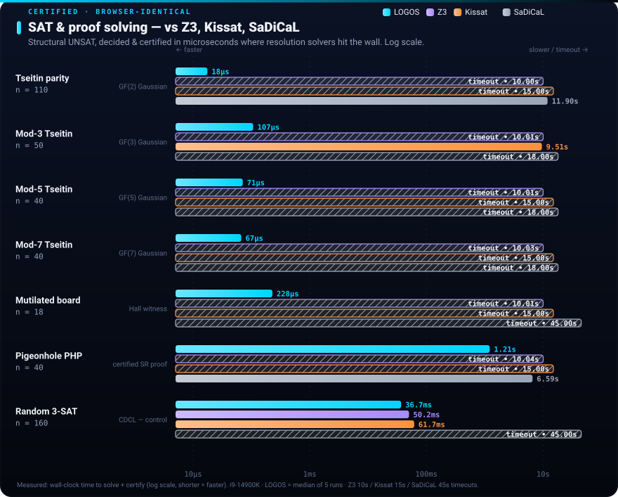
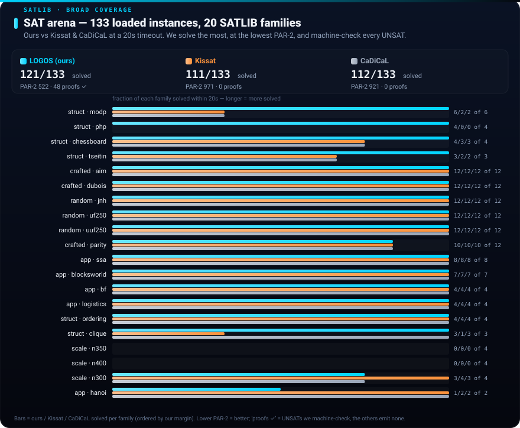
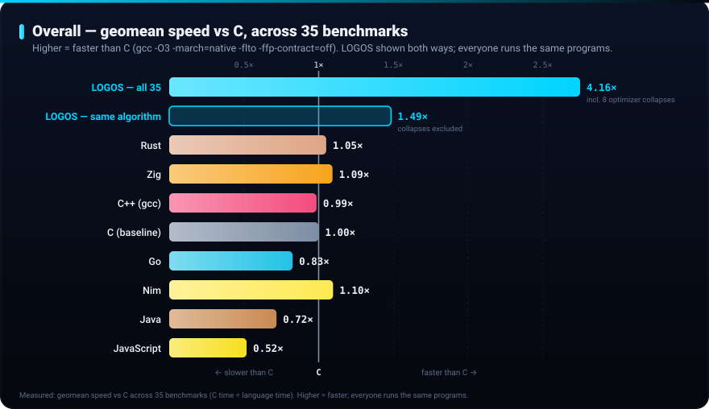
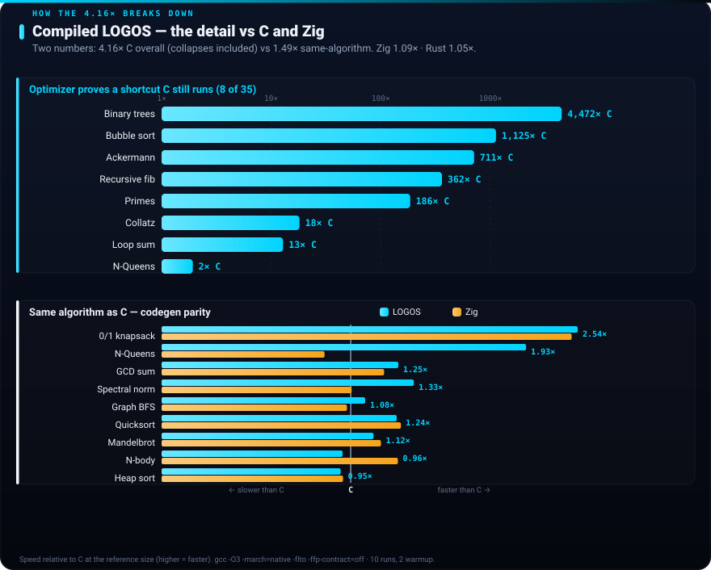
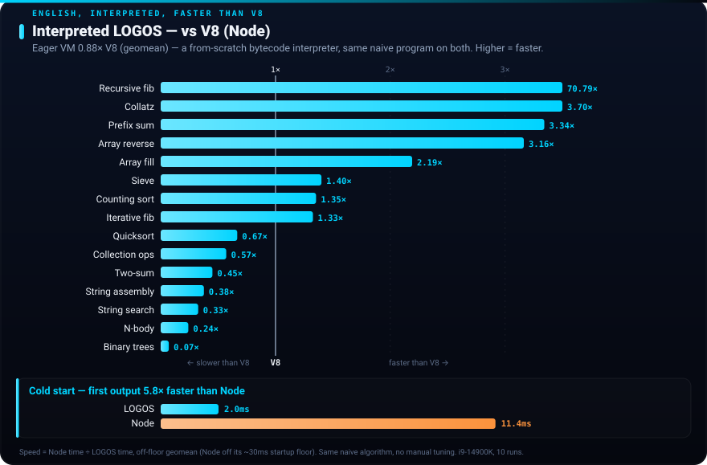
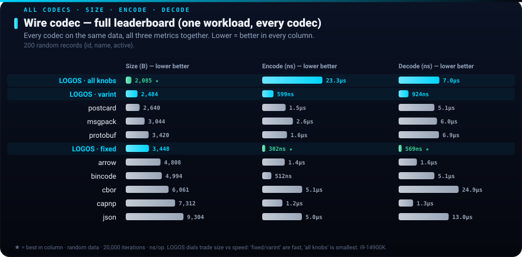
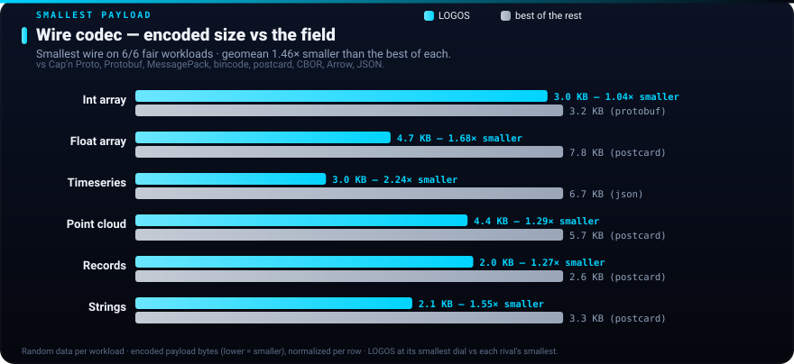
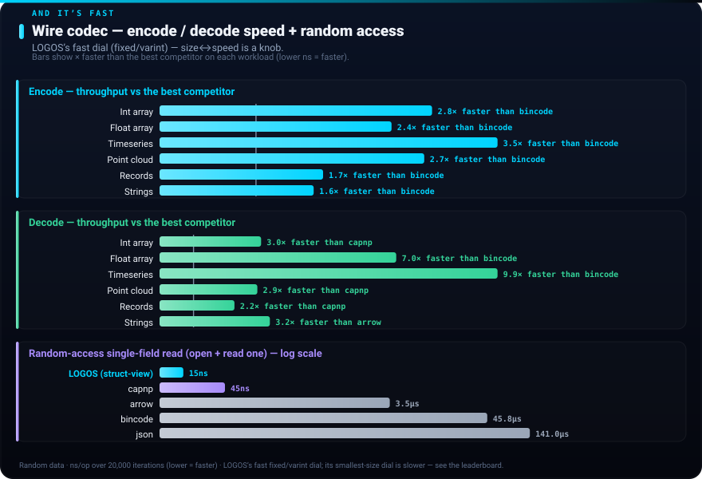

# Logicaffeine

**Our mission: compile the universe's information. Not collect — *compile*, like code.**

[](https://github.com/Brahmastra-Labs/logicaffeine/actions/workflows/test.yml)
[](CHANGELOG.md)
[](https://github.com/Brahmastra-Labs/logicaffeine/actions/workflows/test.yml)
[](LICENSE.md)

**[Try LOGOS online →](https://logicaffeine.com/studio)** · **[Get started in fifteen minutes →](docs/getting-started.md)**

---

## What is it?

Logicaffeine is a **natural-language compiler**. You write English; it emits a formal artifact. The language is
called **LOGOS**, and it has two modes that share one parser:

| Mode | Input | Output |
|------|-------|--------|
| **Imperative** | English programs | Running code: an interpreter, a bytecode VM and a JIT in-process, or Rust, C, WASM and RISC-V ahead of time |
| **Logic** | English sentences | First-Order Logic (∀, ∃, →, ∧, …) |

**Imperative mode**, English → Rust:

```logos
## To classify (n: Int) -> Text:
    If n is less than 0:
        Return "negative".
    Return "non-negative".
```

```rust
#[inline]
fn classify(n: i64) -> String {
    if (n < 0) {
        return ::std::string::String::from("negative");
    }
    return ::std::string::String::from("non-negative");
}
```

That is the generated code, checked by the doc suite, `#[inline]` hint and all.

**Logic mode**, English → First-Order Logic:

```
"Every man is mortal."   →   ∀x((Man(x) → Mortal(x)))
```

Why not just ask an LLM? Because a model guesses and a compiler parses. "Every woman loves a man" has two readings
(each woman loves some man, or one man is loved by all of them); a model quietly picks one, and LOGOS hands you both.
The same idea runs through the whole project: a proof is accepted only when the kernel checks it, a compiled program
has to agree with the reference interpreter, and every example in these docs is run by the test suite.

> **Early access.** LOGOS is well tested, but the language surface is still settling and may change. Please file
> bugs and feature requests as GitHub issues.

---

## Table of contents

- [Quick start](#quick-start)
- [A complete example: merge sort](#a-complete-example-merge-sort)
- [What's inside](#whats-inside)
- [Benchmarks](#benchmarks)
- [Workspace map](#workspace-map)
- [Documentation](#documentation)
- [Project](#project)

---

## Quick start

One line on Linux and macOS (x64 and arm64):

```bash
curl -fsSL https://logicaffeine.com/install.sh | sh
```

Windows:

```powershell
irm https://logicaffeine.com/install.ps1 | iex
```

That installs `largo`, the LOGOS build tool, SHA-256-verified against the release's `SHA256SUMS`; nothing runs as
root and no shell config is edited. Add `--full` (`sh -s -- --full`) for the build with Z3 static verification
bundled. Prefer cargo? `cargo install logicaffeine-cli` works too.

```console
$ largo new hello
Created LOGOS project 'hello'
$ cd hello
$ largo run --interpret
Hello, world!
```

`--interpret` runs in-process and needs nothing else installed. Plain `largo run` compiles to a native binary through
cargo, so it needs a Rust toolchain; `largo doctor` tells you what you have. From there, `largo test` runs the tests,
`largo new site --web` scaffolds a full-stack site, `largo serve` serves it, `largo logic "…"` turns a sentence into
logic, and `largo repl` is the interactive session. [Getting started](docs/getting-started.md) walks through each one.

**No install:** the [Studio](https://logicaffeine.com/studio) runs the whole engine (parser, interpreter, proof engine,
code generation) client-side in WebAssembly.

**As a library:**

```rust
// Logic mode: English → First-Order Logic
let fol = logicaffeine_language::compile("Every man is mortal.")?;
// → "∀x((Man(x) → Mortal(x)))"

// Imperative mode: English → a self-contained Rust module
let rust = logicaffeine_compile::compile_to_rust("## Main\nReturn 42.")?;
// → a module that runs `Main` on a large-stack worker thread
```

Both return `Result<String, ParseError>`. See
[`logicaffeine_language`](crates/logicaffeine_language/README.md) and
[`logicaffeine_compile`](crates/logicaffeine_compile/README.md).

**Working on LOGOS itself:**

```bash
cargo build                                                   # the default members; no Z3 needed
cargo nextest run -p logicaffeine-tests --test doc_examples   # one test suite
./scripts/run-all-tests-fast.sh                               # the full suite, on every core
dx serve -p logicaffeine-web                                  # the web IDE (run from the repo root)
```

[CONTRIBUTING](.github/CONTRIBUTING.md) has the rest.

---

## A complete example: merge sort

A full recursive algorithm, written entirely in English: functions, typed collections, 1-indexed inclusive slicing,
ownership (`copy of`), and control flow. This program compiles and runs
([`grand_challenge_mergesort.rs`](crates/logicaffeine_tests/tests/grand_challenge_mergesort.rs)):

```logos
## To Merge (left: Seq of Int) and (right: Seq of Int) -> Seq of Int:
    Let result be a new Seq of Int.
    Let i be 1.
    Let j be 1.
    Let n_left be length of left.
    Let n_right be length of right.

    While i is at most n_left and j is at most n_right:
        Let l_val be item i of left.
        Let r_val be item j of right.
        If l_val is less than r_val:
            Push l_val to result.
            Set i to i + 1.
        Otherwise:
            Push r_val to result.
            Set j to j + 1.

    While i is at most n_left:
        Let v be item i of left.
        Push v to result.
        Set i to i + 1.
    While j is at most n_right:
        Let v be item j of right.
        Push v to result.
        Set j to j + 1.

    Return result.

## To MergeSort (items: Seq of Int) -> Seq of Int:
    Let n be length of items.
    If n is less than 2:
        Return copy of items.
    Let mid be n / 2.
    Let left_slice be items 1 through mid.
    Let right_slice be items (mid + 1) through n.
    Let sorted_left be MergeSort(copy of left_slice).
    Let sorted_right be MergeSort(copy of right_slice).
    Return Merge(sorted_left, sorted_right).

## Main
    Let numbers be a new Seq of Int.
    Push 3 to numbers. Push 1 to numbers. Push 4 to numbers.
    Push 1 to numbers. Push 5 to numbers.
    Let sorted be MergeSort(numbers).
    Show sorted.
```

→ [The imperative-mode guide](docs/imperative-mode.md) covers each construct in depth.

---

## What's inside

Two languages sharing one parser, a set of execution tiers and backends behind them, a proof kernel underneath, and
one build tool in front. Each section links to a guide, and every example in those guides runs in the test suite.

### Full-stack web apps (LGX)
Most web stacks spread one feature across three languages and a build pipeline. An LGX page is one file: `State:`
holds what it knows, `Actions:` says what it does in English sentences, `View:` is HTML with `{…}` holes, and `Style:`
is CSS scoped to it. A page compiles to WebAssembly; a set of `## Route`s ending in `Serve on port 8080.` is the
server; `largo serve` runs both with live reload.

```logos-dom
## Page /

State:
    Let clicks be 0.

Actions:
    To bump:
        Set clicks to clicks + 1.

View:
    <button id="more" on-click={bump}>Clicked {clicks} times</button>

## Test: each click counts once

Click "#more".
Click "#more".
Expect that the text of "#more" is equal to "Clicked 2 times".
```

The `## Test` drives the page in-process, on the tree-walker and the bytecode VM, no browser needed.
→ **[docs/frontend.md](docs/frontend.md)** (pages) and **[docs/web.md](docs/web.md)** (the server)

### Tests written in the language
`## Test: <a sentence>` sits beside the code it checks. A failed `Expect that …` renders the condition back to
English with the value of each part; `For all integers a and b:` samples seeded cases and shrinks a counterexample.
`largo test` runs every test in a sealed world (a frozen clock, an in-memory filesystem, seeded randomness, no
network) and ends with an earned rank, so a green run on your laptop is a green run in CI. A failing interpreted run
writes a `.replay` bundle that `largo replay` re-runs exactly.
→ **[docs/imperative-mode.md](docs/imperative-mode.md)**

### Imperative LOGOS: English that runs
A statically typed language: variables and mutation, `Int`, `Nat`, `Real`, `Rational`, `Bool`, `Text`, `Uuid` and
machine words `Word8`–`Word64`, user structs, sum-type enums, generics, closures, **1-indexed** collections with
inclusive slices, pattern matching, ownership and borrow checking, contracts, modules, and FFI.
→ **[docs/imperative-mode.md](docs/imperative-mode.md)**

### Logic LOGOS: English that means something
English → First-Order Logic with deep linguistic coverage: quantifiers and their scope ambiguities, modal logic
(Kripke semantics), tense, aspect and LTL, neo-Davidsonian event semantics, λ-calculus and Montague types, and a long
tail of phenomena (presupposition, ellipsis, counterfactuals, binding…). When a sentence has two readings, you get
both. → **[docs/logic-mode.md](docs/logic-mode.md)**

### One front end, many ways to run
In-process: a tree-walking interpreter, a register bytecode VM, and **EXODIA**, a copy-and-patch JIT that turns hot
VM code into native code. Ahead of time: Rust (then cargo), a general C backend, a direct WASM backend with no rustc
in the loop, and RISC-V assembly. `largo emit` also writes device bundles: the CUDA and Tenstorrent ones carry a C
oracle that is checked against the VM. The tree-walking interpreter is the reference the other tiers are tested
against; compiled LOGOS is benchmarked against C and ten other languages, and the VM against V8.
→ **[docs/execution-and-performance.md](docs/execution-and-performance.md)**

### Proofs you can check
Search can be heuristic, but acceptance is checked. Underneath everything is a Calculus of Constructions kernel with
decision procedures (`ring`, `lia`, `cc`, `omega`) and an independent second checker; above it sit a backward-chaining
proof engine with Socratic hints, SAT solving with machine-checkable DRAT/LRAT certificates, Lean 4 import re-checked
by both kernels, and optional Z3 static verification. Translation validation checks the source side of a compile
today; the emitted-Rust side is not closed yet. → **[docs/proof-and-verification.md](docs/proof-and-verification.md)**

### Concurrency & distributed systems
Structured concurrency, channels and `Select`, agents and message passing, CRDTs for shared state, and a scheduler
whose choices are a function of its seed, so a flaky interleaving replays exactly. Networking runs over a WebSocket
relay, with a libp2p mesh as an opt-in feature. → **[docs/concurrency.md](docs/concurrency.md)**

### Cryptography written in LOGOS
The standard library's crypto layer is LOGOS source, not FFI: ChaCha20-Poly1305, SHA-256, HMAC and PBKDF2, the
Keccak permutation behind SHA-3 and SHAKE, and the NTT and modular-reduction building blocks of post-quantum ML-KEM-768
and ML-DSA, in [`crypto.lg`](crates/logicaffeine_compile/assets/std/crypto.lg), built on `Word8`–`Word64` and SIMD
lane types. [`uuid.lg`](crates/logicaffeine_compile/assets/std/uuid.lg) implements RFC 9562 UUIDs, MD5 and SHA-1
included. Every primitive is checked bit-exact against FIPS and reference oracles on every execution tier.
→ **[docs/imperative-mode.md](docs/imperative-mode.md)**

### Studio IDE + Learn Logic
A browser IDE with Logic, Code, Math, Hardware and Web modes, a streaming REPL and compile-to-Rust, plus a Learn
roadmap (four eras of short lessons, SM-2 spaced repetition), all running in WASM.
→ **[docs/studio-and-learn.md](docs/studio-and-learn.md)**

### `largo`, the build tool
A Cargo-style front door to the whole engine, driven by a `Largo.toml` manifest: scaffold (`new`, `init`, `add`),
build, run and serve, test, replay and debug, translate English to logic, prove theorems, solve SAT instances, import
Lean, format, serve an MCP endpoint for agents, and publish to the registry. → **[docs/cli.md](docs/cli.md)**

---

## Benchmarks

Measured, not asserted. The interactive suite lives at
[logicaffeine.com/benchmarks](https://logicaffeine.com/benchmarks); the charts below are regenerated from
[`benchmarks/results/`](benchmarks/results/) by [`gen-readme-charts.py`](benchmarks/gen-readme-charts.py), and the
numbers quoted under each one are the numbers it drew.

### SAT & certified proof

<p align="center">
  
</p>

Structured unsatisfiable families (parity constraints, pigeonhole, the mutilated chessboard) are where
resolution-based solvers hit an exponential wall. LOGOS recognizes the structure, decides it algebraically or
combinatorially, and emits a certificate a checker verifies. On random 3-SAT, where there is no structure to find, it
simply keeps pace.

<p align="center">
  
</p>

Measured across 133 loaded SATLIB instances in 20 families: LOGOS solves 121 of 133 at PAR-2 522 with 48
machine-checked proofs.

### Compiled, vs C

<p align="center">
  
</p>

Geomean speed relative to C across 35 benchmarks: LOGOS 4.16x with the optimizer's collapses counted, and 1.49x
same-algorithm without them. Both numbers matter, and the gap between them is the story of the next chart.

<p align="center">
  
</p>

8 benchmarks collapse by 2x to 4472x because the optimizer proves a shortcut (a closed form, a heap sort for a nest of
exchanges, a tree it never builds, one sieve for a divisor search per number, a table of finished starts) that C
still executes. The rest run the same algorithm in both languages, which
makes them a codegen comparison.

### Interpreted, vs V8

<p align="center">
  
</p>

On the same naive algorithms, the eager bytecode VM geomeans 0.88x V8, and it reaches first output about 5.8x
faster than Node because there is no engine to warm up.

### Wire codec

<p align="center">
  
</p>

<p align="center">
  
</p>

On random data, where no codec gets a free ride from repetition, the smallest LOGOS setting is geomean 1.46x
smaller than the best of the field.

<p align="center">
  
</p>

Its fixed/varint setting encodes up to 3.5x and decodes up to 9.9x faster than the best competitor. Size and speed
are a dial you set per message, not a fork you choose once.

How the execution tiers behind these numbers work →
**[docs/execution-and-performance.md](docs/execution-and-performance.md)**.

---

## Workspace map

Crates are layered into dependency tiers (a crate's tier is the length of its longest chain of internal
dependencies, so every edge points to a lower tier) and protected by four architectural invariants: **Milner**
(the kernel never sees the lexicon), **Liskov** (the proof engine is independent of the language), **Lamport** (data
structures are IO-free and WASM-safe), and **Tarski** (the verification IR is decoupled from the main AST). See
**[docs/architecture.md](docs/architecture.md)** for the full picture.

| Tier | Crate | Role |
|------|-------|------|
| 0 | [logicaffeine_base](crates/logicaffeine_base/README.md) | Arenas, interning, spans, and exact numeric, money, time and UUID types |
| 0 | [logicaffeine_runtime](crates/logicaffeine_runtime/README.md) | Deterministic concurrency runtime (tokio-free, WASM-safe) |
| 0 | [logicaffeine_forge](crates/logicaffeine_forge/README.md) | Copy-and-patch JIT executable-memory layer (native) |
| 0 | [logicaffeine_verify](crates/logicaffeine_verify/README.md) | Z3 static verification (Z3-gated, opt-in) |
| 0 | [logicaffeine_lexicon](crates/logicaffeine_lexicon/README.md) | English vocabulary types + compile-time lexicon |
| 1 | [logicaffeine_kernel](crates/logicaffeine_kernel/README.md) | Calculus of Constructions + decision procedures |
| 1 | [logicaffeine_data](crates/logicaffeine_data/README.md) | Runtime values, the wire format and CRDTs (IO-free) |
| 1 | [logicaffeine_synth](crates/logicaffeine_synth/README.md) | Z3 specifications and witness checks for the JIT's stencils (Z3-gated) |
| 2 | [logicaffeine_system](crates/logicaffeine_system/README.md) | Platform IO, networking, persistence |
| 2 | [logicaffeine_proof](crates/logicaffeine_proof/README.md) | Kernel-checked proof search, tactics and certified SAT |
| 3 | [logicaffeine_language](crates/logicaffeine_language/README.md) | The front end: English → logic, and the LOGOS and LGX parser |
| 4 | [logicaffeine_compile](crates/logicaffeine_compile/README.md) | LOGOS compilation: parse → analyze → codegen / interpret / VM |
| 5 | [logicaffeine_jit](crates/logicaffeine_jit/README.md) | Wires the forge JIT into the VM (native) |
| 5 | [logicaffeine_lsp](crates/logicaffeine_lsp/README.md) | Language Server Protocol (`logicaffeine-lsp`) |
| 5 | [logicaffeine_tv](crates/logicaffeine_tv/README.md) | Translation validation, source side (Z3-gated) |
| 5 | [logicaffeine_wirebench](crates/logicaffeine_wirebench/README.md) | Wire-codec benchmarks vs industry serializers |
| 7 | [logicaffeine_tests](crates/logicaffeine_tests/README.md) | The integration test suite |

> `verify`, `tv`, `synth`, and `wirebench` sit outside `default-members`, so a plain `cargo build` builds none of
> them and needs no Z3 toolchain. `verify`, `tv` and `synth` build when the `verification` feature pulls them in;
> `wirebench` builds as a dev-dependency of the test suite.

**Applications**

| App | What it is |
|-----|-----------|
| [logicaffeine_cli](apps/logicaffeine_cli/README.md) | The `largo` build tool & package manager |
| [logicaffeine_web](apps/logicaffeine_web/README.md) | The Studio IDE + Learn Logic (Dioxus + WASM) |
| [logicaffeine_docs](apps/logicaffeine_docs/README.md) | Documentation app *(standalone, not a workspace member)* |

**Services** (Cloudflare Workers)

| Service | What it is |
|---------|-----------|
| [registry](services/registry/) | The package registry `largo publish` talks to (Workers + D1) |

---

## Documentation

Start with **[Getting started](docs/getting-started.md)**: install, a first program and its test, a web page, and
English into logic, in about fifteen minutes. Keep the **[quick guide](LOGOS_QUICKGUIDE.md)** open beside it: every
construct on one page.

The guides live in [`docs/`](docs/):

- [Getting started](docs/getting-started.md): the first fifteen minutes
- [Imperative mode](docs/imperative-mode.md): the LOGOS language
- [Logic mode](docs/logic-mode.md): English → First-Order Logic
- [Frontend](docs/frontend.md): pages in LGX (`## Page`, `## Component`, `## Store`, templates, triggers, page tests, static export)
- [Web](docs/web.md): the server half (`## Route`, requests and responses, cookies, sessions, CSRF, deploying)
- [Concurrency & distributed](docs/concurrency.md): tasks, channels, agents, CRDTs, networking
- [Execution & performance](docs/execution-and-performance.md): interpreter, VM, JIT, AOT and direct WASM
- [Proof & verification](docs/proof-and-verification.md): the kernel, the proof engine, Z3, translation validation
- [The `largo` CLI](docs/cli.md): the build tool and its manifest
- [Studio & Learn](docs/studio-and-learn.md): the web app
- [Architecture](docs/architecture.md): the pipeline, the tier graph, the invariants
- [LGX reference](docs/lgx-reference.md): every LGX construct, generated from the compiler's own catalogues
- [Web standard library](docs/lgx-stdlib.md): the `forms`, `ui` and `session` modules web programs call
- [Error catalog](docs/ERROR_CATALOG.md): every diagnostic code, with its Socratic explanation

Runnable projects, from a counter and a to-do list to a full-stack guestbook, a multi-page site and a SambaNova RDU
lowering, live in [`examples/`](examples/README.md), each with a README.

**Every example is tested.** The doc suite compiles every `logos` block in this README and the guides, runs every one
that shows its output and requires exactly that output, runs every `## Test`, checks every `"English" → logic` pair
against the live compiler, and mounts every page on the tree-walker and the VM. The Quick start above is replayed with
nothing but `largo` on the `PATH`. An example that stops working fails the build.

**For AI agents:** the toolchain is an MCP server. `claude mcp add logos -- largo mcp` gives an agent structured
checking, sandboxed deterministic runs, English → logic, kernel-certified proofs, and the full guide as resources.
`largo check --json` and `largo explain <code>` cover plain-shell agents, and every `largo new` project ships an
`AGENTS.md`.

The test suite ([`crates/logicaffeine_tests/`](crates/logicaffeine_tests/)) is the living specification: features are
organized into phase tests, with differential tests proving the interpreter, VM, JIT and AOT paths agree.

---

## Project

- **Changelog**: [CHANGELOG.md](CHANGELOG.md)
- **Versioning policy**: [VERSIONING.md](docs/project/VERSIONING.md) (lockstep SemVer across the workspace)
- **Contributing**: [CONTRIBUTING.md](.github/CONTRIBUTING.md)
- **Security**: [SECURITY.md](.github/SECURITY.md)
- **FAQ**: [docs/project/FAQ.md](docs/project/FAQ.md)
- **The public challenge**: [docs/project/CHALLENGE.md](docs/project/CHALLENGE.md)
- **License**: [MIT](LICENSE.md) for everything the tree authors. What it carries from elsewhere keeps its authors'
  license, stated beside it: Berkeley SoftFloat (BSD-3-Clause), the RISC-V ISA tests (BSD-3-Clause), the Lean kernel
  arena's cases (Apache-2.0), OpenLane's flow scripts (Apache-2.0), the Math editor's font (Bitstream-Vera) and the
  terminal font (MIT).
- **Acknowledgements**: the kernel's Lean checker builds on the Lean 4 kernel, lean4lean, smalltt, sokonanoda, nanoda,
  mathgraph, nano-lean, lean4export and the Lean Kernel Arena, each credited for what it gave in the
  [kernel README](crates/logicaffeine_kernel/README.md#acknowledgements).

---

*"In the beginning was the Word, and the Word was with Logic, and the Word was Code."*
